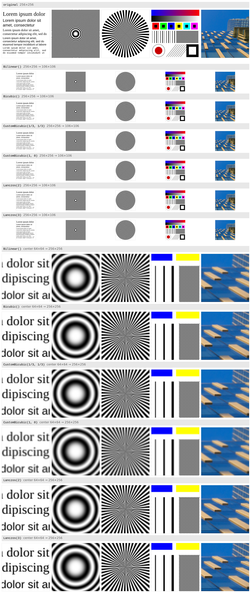

# arez

[](https://pkg.go.dev/github.com/pgaskin/arez)
[](https://github.com/pgaskin/arez/actions/workflows/test.yml)
[](https://github.com/pgaskin/arez/actions/workflows/fuzz.yml)

Go image resizing library with amd64/arm64/wasm SIMD support. Based on [`rez`](https://github.com/bamiaux/rez), but rewritten to use [`archsimd`](https://pkg.go.dev/simd/archsimd), with amd64/arm64/wasm support, more image formats, and a modernized API. Requires `GOEXPERIMENT=simd`, otherwise it falls back to an unoptimized implementation.

### Features

#### Original

- Supports `YCbCr`, `Gray`, `RGBA`, and `NRGBA` images.
- Supports `YCbCr` subsample ratio conversions.
- Supports interlaced resizes.
- Supports parallel resizing.
- Supports SIMD on amd64.

#### New

- Modernized code.
- Proper error types.
- Requires Go 1.27 or later.
- Slightly faster on amd64.
- Supports nearest neighbour, box, and fractional lanczos filters.
- Supports faster approximate large downscales (like Pillow's [`reducing_gap`](https://pillow.readthedocs.io/en/latest/reference/Image.html#PIL.Image.Image.resize)).
- Supports SIMD on arm64 and wasm.
- Supports `Alpha`, `CMYK`, `NYCbCrA`, `Gray16`, `Alpha16`, `RGBA64`, and `NRGBA64` images.
- Supports premultiplying alpha for `NRGBA`, `NRGBA64`, and `NYCbCrA`.
- Supports rows larger than 32767 bytes (i.e., 8192 pixels RGBA).
- Supports concurrent use of a `Converter`.
- All outputs are bit-identical to a fallback Go implementation, which itself is almost identical to the original one.
- Fixed many buffer overflows and out-of-bound reads.
- Fixed many crashes with weirder image layouts.
- Added fuzzers and tests against simpler (but slower) versions.

### Usage

To convert a single image:

```go
err := arez.Convert(output, input, arez.Bicubic())
```

If you need to convert video, where resize parameters are the same for multiple images, you can do something like:

```go
cfg, err := arez.Prepare(output, input)
converter, err := arez.NewConverter(cfg, arez.Bicubic())
for i := range input {
	err := converter.Convert(output[i], input[i])
}
```

You can also use `arez.NewResizer` to resize raw image data.

### Notes

Paletted images and other image.Image implementations are not supported and need to be converted first (e.g., with [`image/draw`](https://pkg.go.dev/image/draw)).

Channels are filtered independently, which is correct for premultiplied alpha (RGBA, RGBA64), but may bleed transparent colors into visible pixels for images with straight alpha (NRGBA, NRGBA64, NYCbCrA).

By default, images are resized in parallel with `GOMAXPROCS` slices.

Input planes need at least 2 pixels in each direction (2 rows per field when interlaced), and rows are limited to `2^31-1` bytes (`NewConverter` returns an error otherwise).

I used Claude Fable 5.1 to help port and verify parts of the SIMD code (it's a lot of tedious and mostly mechanical work), write the tests, and help find/test micro-optimizations, but the rest is mostly done by hand.

### Filters

<sub><b>Note:</b> The comparison should be viewed at full size (open the image in a new tab and zoom to 100%).</sub>

[](https://raw.githubusercontent.com/pgaskin/arez/master/preview/compare.png)

<!-- note: raw.githubusercontent.com directly so clicking opens the image itself, and so it renders properly in docs -->
